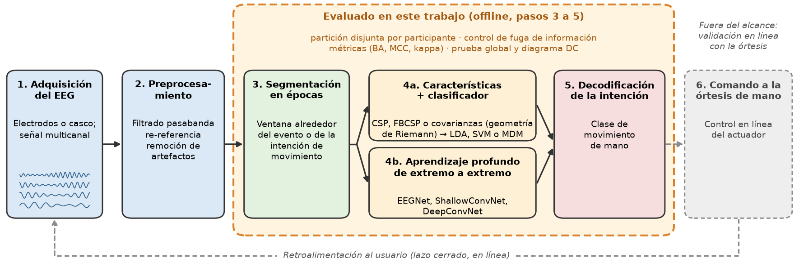
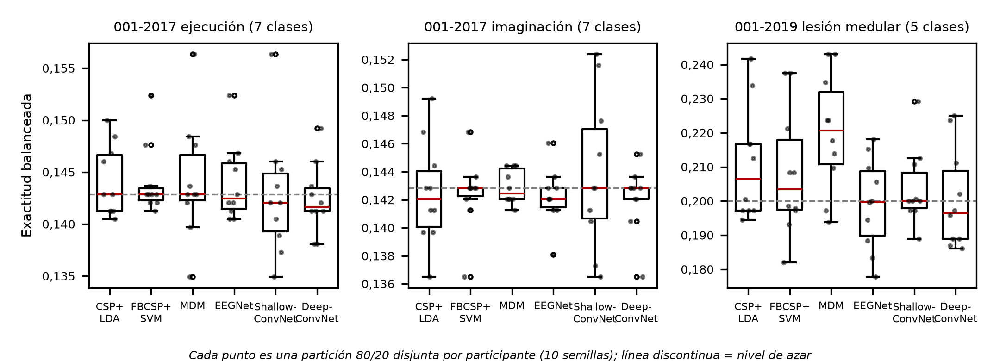
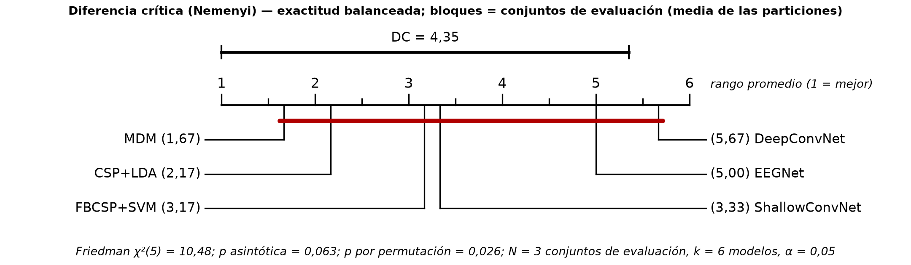
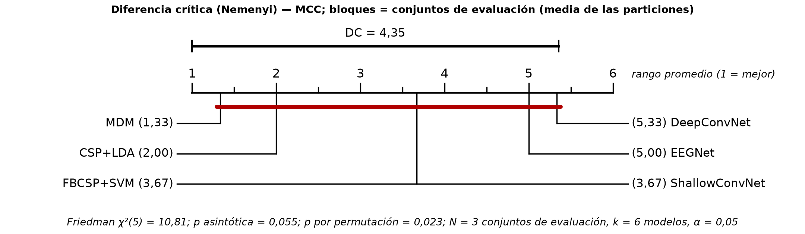

# Protocolo de evaluación comparativa con diagrama de diferencia crítica para decodificar la intención de movimiento de mano desde EEG orientado a órtesis en lesión medular

[](LICENSE)
[](https://www.python.org/)
[](https://colab.research.google.com/github/carlosferrinbolanos-design/Protocolo-Evaluacion-Modelos-Clasificacion-EEG-Intencion-Movimiento/blob/main/TESIS_pipeline_reproducible.ipynb)
[](docs/CHANGELOG.md)

> **Actualización (21-11-2026): la versión citada en el artículo es la corrida v5, en [`v5/`](v5/README.md).** Allí están el código de la corrida v5, la ablación de banda (A1, A2, B1 y C1 Tensor-CSPNet), las tablas agregadas y la procedencia (SHA-256) de cada script. El contenido de la raíz (`v1.0-articulo`) corresponde a la evaluación v2, declarada piloto no citable el 14-11-2026; se conserva como registro histórico.

**Repositorio de verificación de la reproducibilidad del artículo.** Contiene el código, la configuración, los manifiestos de épocas, las predicciones por época, las tablas, las figuras y un cuaderno documentado. Con ellos, cualquier revisor puede regenerar y comprobar cada número publicado. **No contiene datos EEG:** se descargan de sus fuentes oficiales.

**Autores:** David Aogusto Rodriguez Chamorro (estudiante) y Carlos Diego Ferrin Bolaños (director). Universidad Santiago de Cali, Facultad de Ingeniería, Maestría en Informática.

## Resumen
La decodificación de la intención de movimiento de mano a partir del EEG se propone para controlar órtesis en lesión medular, pero suele evaluarse con particiones aleatorias por ensayo, que permiten la **fuga de información** entre sujetos, y con comparaciones de dos modelos sobre un solo conjunto de datos. Este trabajo propone y aplica un protocolo de evaluación comparativa en cuatro etapas (**Análisis → Diseño → Implementación → Pruebas**).

El protocolo compara seis modelos (**CSP+LDA, FBCSP+SVM, MDM, EEGNet, ShallowConvNet y DeepConvNet**) en conjuntos públicos de BNCI Horizon 2020 (001-2017, 001-2019 y 001-2020) con estas reglas:
- particiones **80/20 disjuntas por participante**;
- **control por permutación de etiquetas**;
- métricas corregidas por azar (**exactitud balanceada, F1 macro, kappa y MCC**);
- **prueba global** de Friedman y **diagrama de diferencia crítica (DC)** de Nemenyi, complementados con Wilcoxon-Holm y una prueba bayesiana con ROPE.

Con 10 particiones repetidas, ningún modelo supera de forma significativa al azar en 001-2017. En 001-2019 (lesión medular), solo el MDM queda consistentemente por encima del azar (0,220 frente a 0,200), sin significancia después de Holm, y ningún par de modelos difiere según Nemenyi.

> **Conjunto de evaluación:** cada combinación de conjunto de datos y condición que se evalúa por separado (001-2017 ejecución, 001-2017 imaginación, 001-2019 lesión medular; 001-2020 gel, agua y seco). En las pruebas estadísticas, cada conjunto de evaluación actúa como un bloque.

## Alcance de la evaluación (Figura 1)



**Figura 1.** Flujo de una BCI motora para el control de una órtesis de mano y alcance de la evaluación de este trabajo. El recuadro naranja delimita el alcance de la **evaluación offline**, que cubre los **pasos 3 a 5** (segmentación en épocas, extracción de características o aprendizaje profundo, y decodificación de la intención). El **paso 6** (comando a la órtesis de mano) y la validación en línea en lazo cerrado quedan **fuera del alcance**. El script que genera la figura es [`scripts/make_fig_pipeline_bci.py`](scripts/make_fig_pipeline_bci.py). Esta versión del repositorio corresponde a la versión final del artículo (noviembre 2026).

## Cita
> Rodriguez Chamorro, D. A., y Ferrin Bolaños, C. D. (2026). *Protocolo de evaluación comparativa con diagrama de diferencia crítica para decodificar la intención de movimiento de mano desde EEG orientado a órtesis en lesión medular.* [Revista, volumen, páginas y DOI por completar cuando se publique.]

Ver también [`CITATION.cff`](CITATION.cff). Si usa los datos, cite además a Ofner et al. (2017, 2019) y Schwarz et al. (2020) (ver [docs/DATOS.md](docs/DATOS.md)).

## Inicio rápido
**A. Verificar la estadística en 5 minutos, sin datos EEG ni GPU:**
```bash
git clone https://github.com/carlosferrinbolanos-design/Protocolo-Evaluacion-Modelos-Clasificacion-EEG-Intencion-Movimiento.git && cd Protocolo-Evaluacion-Modelos-Clasificacion-EEG-Intencion-Movimiento
pip install -r requirements.txt
export RESULTADOS=$(mktemp -d) && cp -r preds $RESULTADOS/ && mkdir $RESULTADOS/tables $RESULTADOS/figures
python scripts/04_analyze.py && python scripts/04b_pairwise_LME.py && python scripts/05_tables.py && python scripts/06_fig_cajas.py
python scripts/verificar_resultados.py --regenerado $RESULTADOS/tables --estricto   # → RESULTADO: VERIFICADO
```
**B. Reproducir todo desde los datos públicos:** abra el cuaderno en Colab (botón de arriba), elija GPU T4, fije `MODO = "RAPIDO"` o `"COMPLETO"` y ejecute todo.

## Mapa del repositorio
```
├── TESIS_pipeline_reproducible.ipynb   # cuaderno de extremo a extremo (sin ejecutar), estructurado como el artículo
├── RESULTS.md                          # informe completo de las ejecuciones (16-11-2026)
├── scripts/                            # código que produjo los números publicados
│   ├── core.py                         #   particiones 80/20 disjuntas por participante, permutación, guardado
│   ├── 01_extract_epochs.py            #   épocas desde los manifiestos (Análisis/Diseño)
│   ├── 02_run_classical.py             #   CSP+LDA, FBCSP+SVM, MDM (Implementación)
│   ├── deep_core.py, 03_run_deep.py    #   EEGNet, ShallowConvNet, DeepConvNet (--weighted_cosine en 001-2019)
│   ├── 04_analyze.py, 04b_pairwise_LME.py  # métricas, Friedman/Nemenyi/DC, Wilcoxon-Holm, Bayes, azar (Pruebas)
│   ├── 05_tables.py, 06_fig_cajas.py   #   tablas y figuras en español
│   ├── make_fig_pipeline_bci.py        #   Figura 1 del artículo (pipeline de la BCI motora)
│   ├── verificar_resultados.py         #   comparación de lo regenerado con lo publicado, con tolerancias
│   ├── build_notebook.py, terminologia.py  # generación del cuaderno
│   └── colab/                          #   lanzadores usados en Colab (VMs efímeras)
├── configs/                            # configuración establecida del estudio (JSON)
├── manifests/                          # manifiestos de épocas (metadatos; sin señal)
├── preds/                              # 216 predicciones por época (.csv.gz) + metadatos (1,8 MB)
├── tables/                             # tablas publicadas (CSV, JSON, Markdown en español)
│   ├── anteriores_sin_ponderacion_ni_scheduler/   # v1: redes de 001-2019 sin ponderación ni programador
│   └── v3_particion_unica_estudio/     # ejecución v3 del estudio (partición única, 6 conjuntos de evaluación)
├── figures/                            # Figura 1 (pipeline BCI), diagramas DC y figuras de cajas (PNG 300 ppp, SVG, PDF)
└── docs/                               # METODOLOGIA, DATOS, MODELOS, ESTADISTICA, REPRODUCIBILIDAD, RESULTADOS, LIMITACIONES, CHANGELOG
```

## Guía de reproducción paso a paso
| Modo | Pasos | Hardware | Tiempo estimado | Unidades de cómputo Colab |
|---|---|---|---|---|
| Estadística desde `preds/` | Inicio rápido A, o cuaderno con `USAR_PREDICCIONES_GUARDADAS = True` | CPU | < 5 min | 0–0,2 |
| `RAPIDO` | Cuaderno: 0-1 (clonar + instalar) → 0-2 (configuración) → A-1 (descarga de unos 28 GB de Zenodo) → A-2 (épocas) → B-1 (particiones) → P-1 (k = 0, 6 modelos) → P-2…P-7 | Colab con GPU T4 (unos 12 GB de RAM y 40 GB de disco) | 1,5–2 h | 3–4 |
| `COMPLETO` | Igual que RAPIDO, con k = 0…9 y permutación en k = 0, 1 (216 corridas) | Colab con GPU T4 | 8–10 h en una VM (o unas 1,5 h repartido en 4 VMs, como en el estudio) | 12–18 (el estudio usó 3,21 con VMs en paralelo y modelos clásicos en CPU) |

Detalles, semillas, límites del determinismo y lista de verificación para revisores: [docs/REPRODUCIBILIDAD.md](docs/REPRODUCIBILIDAD.md).

## Salidas esperadas
**Exactitud balanceada y MCC (media ± DE en 10 particiones; `tables/summary_mean_sd.csv`).** El azar de la exactitud balanceada es 0,143 en 001-2017 y 0,200 en 001-2019; el del MCC es 0.

| Conjunto de evaluación | Modelo | Exactitud balanceada | MCC |
|---|---|---|---|
| 001-2017 ejecución (ME) | CSP+LDA | 0,144 ± 0,003 | 0,002 ± 0,005 |
| 001-2017 ejecución (ME) | FBCSP+SVM | 0,144 ± 0,003 | 0,001 ± 0,006 |
| 001-2017 ejecución (ME) | MDM | 0,144 ± 0,006 | 0,001 ± 0,008 |
| 001-2017 ejecución (ME) | EEGNet | 0,144 ± 0,004 | 0,001 ± 0,005 |
| 001-2017 ejecución (ME) | ShallowConvNet | 0,143 ± 0,006 | 0,000 ± 0,008 |
| 001-2017 ejecución (ME) | DeepConvNet | 0,142 ± 0,003 | -0,001 ± 0,006 |
| 001-2017 imaginación (MI) | CSP+LDA | 0,142 ± 0,004 | 0,000 ± 0,008 |
| 001-2017 imaginación (MI) | FBCSP+SVM | 0,142 ± 0,003 | 0,000 ± 0,006 |
| 001-2017 imaginación (MI) | MDM | 0,143 ± 0,001 | 0,001 ± 0,006 |
| 001-2017 imaginación (MI) | EEGNet | 0,142 ± 0,002 | -0,002 ± 0,005 |
| 001-2017 imaginación (MI) | ShallowConvNet | 0,144 ± 0,005 | 0,001 ± 0,007 |
| 001-2017 imaginación (MI) | DeepConvNet | 0,142 ± 0,002 | -0,001 ± 0,004 |
| 001-2019 lesión medular | CSP+LDA | 0,211 ± 0,017 | 0,014 ± 0,022 |
| 001-2019 lesión medular | FBCSP+SVM | 0,208 ± 0,019 | 0,011 ± 0,025 |
| 001-2019 lesión medular | MDM | 0,220 ± 0,017 | 0,027 ± 0,023 |
| 001-2019 lesión medular | EEGNet | 0,199 ± 0,013 | -0,001 ± 0,018 |
| 001-2019 lesión medular | ShallowConvNet | 0,204 ± 0,011 | 0,005 ± 0,015 |
| 001-2019 lesión medular | DeepConvNet | 0,201 ± 0,015 | 0,001 ± 0,019 |

**Prueba global (`tables/stats.json`, `tables/TABLAS_ES_estadistica.md`):**
- **Bloques = 3 conjuntos de evaluación, exactitud balanceada:** χ²(5) = 10,48; p asintótica = 0,063; p Iman-Davenport = 0,019; p por permutación = 0,026; DC = 4,35. Rangos: MDM 1,67; CSP+LDA 2,17; FBCSP+SVM 3,17; ShallowConvNet 3,33; EEGNet 5,00; DeepConvNet 5,67. Ningún par supera la DC.
- **Bloques = 3 conjuntos de evaluación, MCC:** χ²(5) = 10,81; p = 0,055; p por permutación = 0,023.
- **Bloques alternativos, exactitud balanceada:** partición × conjunto de evaluación (N = 30), p = 0,565; participante × conjunto de evaluación (N = 35), p = 0,518; solo 001-2019 (N = 10), p = 0,227.
- **Por pares:** ningún par de Wilcoxon sobrevive a Holm (p de Holm mínima = 0,238). P(ROPE) ≥ 0,88 en los 15 pares de exactitud balanceada.
- **Frente al azar:** MDM en 001-2019 tiene p = 0,005 sin corregir y p de Holm = 0,088; el resto tiene p de Holm = 1.
- **Control por permutación:** exactitud balanceada de 0,133–0,149 en 001-2017 y 0,175–0,222 en 001-2019, es decir, en el nivel de azar.

**Sumas de verificación:** [`docs/SHA256SUMS.txt`](docs/SHA256SUMS.txt) (tablas, predicciones y cuaderno). Regenerar la estadística desde `preds/` produce tablas idénticas byte a byte. Verifíquelo con `sha256sum -c docs/SHA256SUMS.txt` o con `scripts/verificar_resultados.py --estricto`.

## Correspondencia entre el artículo y el repositorio
| Elemento del artículo | Celda del cuaderno | Script | Archivo de salida |
|---|---|---|---|
| Figura 1: flujo de una BCI motora | — (alcance: evaluación offline, pasos 3 a 5; paso 6 y lazo cerrado fuera de alcance) | `make_fig_pipeline_bci.py` | `figures/Figura_pipeline_BCI.png` |
| Figura 2: etapas del protocolo | Estructura A (Análisis) → B (Diseño) → C (Implementación) → D (Pruebas) | — | [docs/METODOLOGIA.md](docs/METODOLOGIA.md) (diagrama mermaid) |
| Figura 3: flujo PRISMA | No aplica (revisión de literatura) | — | — |
| Tabla 1: conjuntos de evaluación y partición disjunta (k = 0: S08 S13 S15 / S08 S10 S14 / P06 P10) | A-2, B-1 | `01_extract_epochs.py`, `core.py::split` | `preds/*__s0.json` (`test_subjects`), `tables/v3_particion_unica_estudio/` |
| Tabla 2: requisitos del diagrama DC | P-3 (N, k, bloques, independencia) | `04_analyze.py` | `tables/stats.json`, [docs/ESTADISTICA.md](docs/ESTADISTICA.md) |
| Tabla 3: exactitud balanceada real y permutada, partición única (6 conjuntos de evaluación) | P-1, P-2 (k = 0) | v3 del estudio; `02_run_classical.py` y `03_run_deep.py` con k = 0 | `tables/v3_particion_unica_estudio/*.csv`, `tables/reproduccion_semilla0_vs_david.csv` |
| Figura 4: DC con partición única (v2) | P-3 y P-5 con k = 0 | — (figura v2 del estudio) | Valores en `tables/v3_particion_unica_estudio/RESULTADOS_ETIQUETAS_REALES_CONSOLIDADOS_V2.csv` |
| Tabla 4: exactitud balanceada y MCC en 10 particiones (media ± DE) | P-2, P-6 | `04_analyze.py`, `05_tables.py` | `tables/summary_mean_sd.csv`, `tables/TABLAS_ES_listas_para_pegar.md` |
| Tabla 4: rango promedio (N = 3) | P-3 | `04_analyze.py` | `tables/stats.json` → `blocks_strata.avg_ranks`; `tables/TABLAS_ES_estadistica.md` |
| Tabla 4: p de Holm frente al azar en LM | P-4 | `04_analyze.py` | `tables/vs_chance.csv` (`p_holm`) |
| Figura 5: exactitud balanceada en las 10 particiones | P-5 | `06_fig_cajas.py` | `figures/Figura_cajas_exactitud_balanceada.png` |
| Texto: Friedman χ² = 10,48, p = 0,063, p por permutación = 0,026, DC = 4,35 | P-3 | `04_analyze.py` | `tables/stats.json` → `balanced_accuracy.blocks_strata` |
| Texto: Wilcoxon-Holm y ROPE | P-4 | `04_analyze.py`, `04b_pairwise_LME.py` | `tables/pairwise_*.csv` |
| Texto: control por permutación (sin fuga de información) | P-1, P-4 | `02_run_classical.py`, `03_run_deep.py --control labels_permuted_within_train_participant` | `tables/permutation_control.csv` |
| Material suplementario: DC con bloques alternativos y solo LM | P-5 | `04_analyze.py` | `figures/DC_*` |
| Material suplementario: F1 macro y kappa | P-2, P-6 | `05_tables.py` | `tables/TABLAS_ES_listas_para_pegar.md` |

## Figuras
La numeración coincide con la versión final del artículo. La Figura 1 está al inicio; la Figura 3 (PRISMA) y la Figura 4 (DC de la partición única v2) pertenecen al artículo y no se regeneran aquí.

| | |
|---|---|
|  |  |
|  |  |

## Datos
Los registros de BNCI 001-2017 ([10.5281/zenodo.834976](https://doi.org/10.5281/zenodo.834976)), 001-2019 ([10.5281/zenodo.2222268](https://doi.org/10.5281/zenodo.2222268)) y 001-2020 (BNCI Horizon 2020) tienen licencia CC BY 4.0 y **no se redistribuyen**. Ver [docs/DATOS.md](docs/DATOS.md).

## Limitaciones
Las principales son:
- 001-2020 no se pudo descargar el 16-11-2026 (servidor oficial caído), así que solo tiene partición única.
- La prueba global tiene N = 3 bloques.
- Los bloques alternativos no son independientes.
- Las redes en GPU no son deterministas (variación de hasta 0,0125 en exactitud balanceada).
- En 001-2019, las semillas 0/6 y 2/8 repiten el conjunto de prueba.

Lista completa: [docs/LIMITACIONES.md](docs/LIMITACIONES.md).

## Licencia
El código tiene licencia [MIT](LICENSE). Los datos pertenecen a sus autores (CC BY 4.0).
