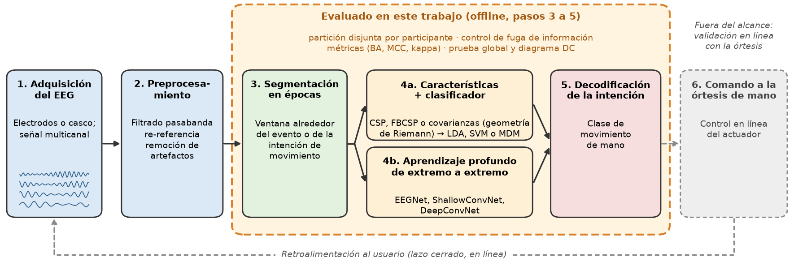
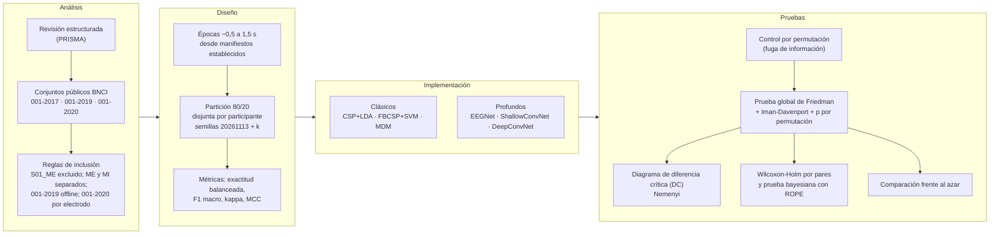

# Metodología: etapas del protocolo

> **Conjunto de evaluación:** cada combinación de conjunto de datos y condición que se evalúa por separado (001-2017 ejecución, 001-2017 imaginación, 001-2019 lesión medular y, si están disponibles, 001-2020 gel, agua y seco). En las pruebas estadísticas, cada conjunto de evaluación actúa como un bloque.

## Figura 1. Flujo de una BCI motora

**Figura 1 del artículo.** Flujo de una BCI motora para el control de una órtesis de mano y alcance de la evaluación de este trabajo. El recuadro naranja delimita el alcance de la **evaluación offline**, que cubre los **pasos 3 a 5** (segmentación en épocas, extracción de características o aprendizaje profundo, y decodificación de la intención). El **paso 6** (comando a la órtesis de mano) y la validación en línea en lazo cerrado quedan **fuera del alcance**. El script que genera la figura es [`scripts/make_fig_pipeline_bci.py`](../scripts/make_fig_pipeline_bci.py).

El protocolo tiene cuatro etapas, que corresponden a la **Figura 2** del artículo: **Análisis → Diseño → Implementación → Pruebas**. Cada etapa tiene una sección en el cuaderno `TESIS_pipeline_reproducible.ipynb` (A, B, C y D) y uno o más scripts en `scripts/`.

## A. Análisis
| Paso | Detalle | Dónde |
|---|---|---|
| Selección de datos | Tres conjuntos públicos de BNCI Horizon 2020 (ver [DATOS.md](DATOS.md)) | cuaderno A-1 |
| Reglas de inclusión | S01_ME excluido; ME y MI son conjuntos de evaluación separados; en 001-2019 solo corridas offline de movimiento intentado (3 598 épocas finitas); en 001-2020, gel, agua y seco por separado, con 4 eventos a menos de 4 s excluidos | manifiestos en `manifests/`, cuaderno A-2 |
| Sin rechazo por amplitud | Las unidades físicas no están demostradas en todas las fuentes, por lo que no se aplica umbral | `configs/CONFIGURACION_CONGELADA_V2_ANTES_CONTROL_PERMUTACION.json` |

## B. Diseño
| Paso | Detalle | Dónde |
|---|---|---|
| Épocas | Ventana de −0,5 s a 1,5 s alineada a la señal; 001-2017 a 512 Hz remuestreado a 256 Hz (513 muestras); 001-2019 a 256 Hz; 001-2020 con 11 canales sensoriomotores comunes | `scripts/01_extract_epochs.py`, cuaderno A-2 |
| Partición | 80/20 disjunta por participante: ⌈20 %⌉ de participantes en prueba con `default_rng(20261113 + k + Σ ord(conjunto de evaluación))`; k = 0 es la partición establecida (Tabla 1); k = 0…9 son las particiones repetidas | `scripts/core.py::split`, cuaderno B-1 |
| Métricas | Exactitud balanceada (principal), F1 macro, kappa de Cohen y MCC; por partición, por participante y matrices de confusión | `scripts/04_analyze.py`, cuaderno P-2 |

## C. Implementación
Seis modelos con hiperparámetros fijos, sin ajuste sobre los datos de prueba (ver [MODELOS.md](MODELOS.md)).

## D. Pruebas
1. **Control por permutación de etiquetas** (k = 0 y k = 1): si no hay fuga de información, el desempeño debe quedar en el nivel de azar.
2. **Prueba global** de Friedman con bloques = conjuntos de evaluación (N = 3) y bloques alternativos (ver [ESTADISTICA.md](ESTADISTICA.md)).
3. **Diagrama de diferencia crítica (DC)** de Nemenyi (Demšar, 2006).
4. **Comparaciones por pares**: Wilcoxon con corrección de Holm y prueba bayesiana de rangos con signo con ROPE.
5. **Comparación frente al azar**: Wilcoxon unilateral sobre las 10 particiones.
