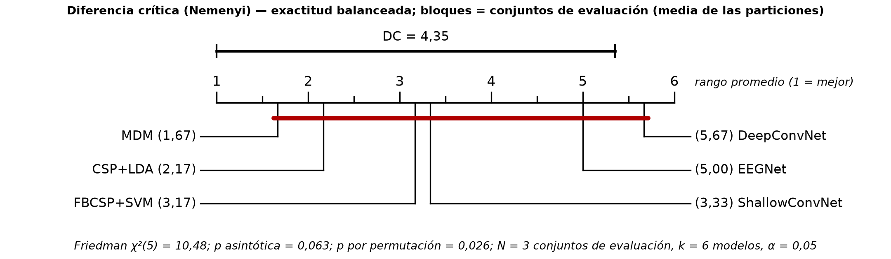
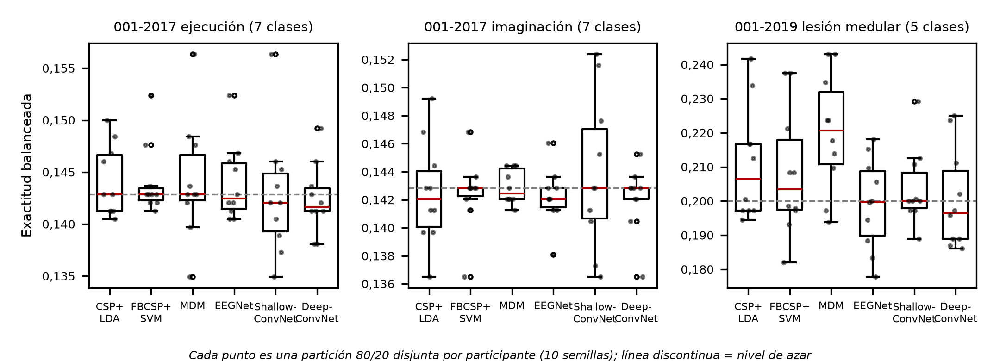

# Resultados

Todos los números provienen de `tables/` y se pueden regenerar desde `preds/` (ver [REPRODUCIBILIDAD.md](REPRODUCIBILIDAD.md)). Configuración: 10 particiones 80/20 disjuntas por participante (semillas 20261113 + k), los seis modelos con hiperparámetros fijos, y redes de 001-2019 con ponderación por clase y programador coseno. Las tablas completas, con F1 macro, kappa, pruebas por pares, comparación frente al azar y control por permutación, están en `tables/TABLAS_ES_listas_para_pegar.md` y `tables/TABLAS_ES_estadistica.md`.

## Exactitud balanceada
**Tabla. Exactitud balanceada en prueba (media ± DE sobre particiones 80/20 disjuntas por participante; semillas 20261113 + k, k = 0…9).**

| Conjunto de evaluación | Azar | CSP+LDA | FBCSP+SVM | MDM | EEGNet | ShallowConvNet | DeepConvNet |
|---|---|---|---|---|---|---|---|
| 001-2017 ejecución (ME) | 0,143 | 0,144 ± 0,003 | 0,144 ± 0,003 | 0,144 ± 0,006 | 0,144 ± 0,004 | 0,143 ± 0,006 | 0,142 ± 0,003 |
| 001-2017 imaginación (MI) | 0,143 | 0,142 ± 0,004 | 0,142 ± 0,003 | 0,143 ± 0,001 | 0,142 ± 0,002 | 0,144 ± 0,005 | 0,142 ± 0,002 |
| 001-2019 LME (offline) | 0,200 | 0,211 ± 0,017 | 0,208 ± 0,019 | 0,220 ± 0,017 | 0,199 ± 0,013 | 0,204 ± 0,011 | 0,201 ± 0,015 |

## MCC
**Tabla. MCC en prueba (media ± DE sobre particiones 80/20 disjuntas por participante; semillas 20261113 + k, k = 0…9).**

| Conjunto de evaluación | Azar | CSP+LDA | FBCSP+SVM | MDM | EEGNet | ShallowConvNet | DeepConvNet |
|---|---|---|---|---|---|---|---|
| 001-2017 ejecución (ME) | 0,000 | 0,002 ± 0,005 | 0,001 ± 0,006 | 0,001 ± 0,008 | 0,001 ± 0,005 | 0,000 ± 0,008 | -0,001 ± 0,006 |
| 001-2017 imaginación (MI) | 0,000 | 0,000 ± 0,008 | 0,000 ± 0,006 | 0,001 ± 0,006 | -0,002 ± 0,005 | 0,001 ± 0,007 | -0,001 ± 0,004 |
| 001-2019 LME (offline) | 0,000 | 0,014 ± 0,022 | 0,011 ± 0,025 | 0,027 ± 0,023 | -0,001 ± 0,018 | 0,005 ± 0,015 | 0,001 ± 0,019 |

## Prueba global y diferencia crítica
**Tabla. Prueba de Friedman y diferencia crítica de Nemenyi (k = 6 modelos, α = 0,05).**

| Métrica | Bloques | N | χ²(5) | p asintótica | p Iman-Davenport | p por permutación | DC | Rangos promedio (1 = mejor) |
|---|---|---|---|---|---|---|---|---|
| Exactitud balanceada | Conjuntos de evaluación (media de particiones) | 3 | 10,48 | 0,063 | 0,019 | 0,026 | 4,35 | MDM 1,67; CSP+LDA 2,17; FBCSP+SVM 3,17; ShallowConvNet 3,33; EEGNet 5,00; DeepConvNet 5,67 |
| Exactitud balanceada | Partición × conjunto de evaluación | 30 | 3,89 | 0,565 | 0,571 | 0,541 | 1,38 | MDM 3,03; CSP+LDA 3,33; FBCSP+SVM 3,48; ShallowConvNet 3,53; EEGNet 3,72; DeepConvNet 3,90 |
| Exactitud balanceada | Participante × conjunto de evaluación | 35 | 4,22 | 0,518 | 0,523 | 0,450 | 1,27 | MDM 3,17; ShallowConvNet 3,29; CSP+LDA 3,31; FBCSP+SVM 3,60; EEGNet 3,70; DeepConvNet 3,93 |
| Exactitud balanceada | Solo sanos (001-2017 ME/MI), partición × conjunto de evaluación | 20 | 0,69 | 0,983 | 0,985 | 0,979 | 1,69 | FBCSP+SVM 3,30; MDM 3,38; CSP+LDA 3,42; EEGNet 3,60; ShallowConvNet 3,60; DeepConvNet 3,70 |
| Exactitud balanceada | Solo LME (001-2019), particiones | 10 | 6,91 | 0,227 | 0,227 | 0,212 | 2,38 | MDM 2,35; CSP+LDA 3,15; ShallowConvNet 3,40; FBCSP+SVM 3,85; EEGNet 3,95; DeepConvNet 4,30 |
| MCC | Conjuntos de evaluación (media de particiones) | 3 | 10,81 | 0,055 | 0,013 | 0,023 | 4,35 | MDM 1,33; CSP+LDA 2,00; FBCSP+SVM 3,67; ShallowConvNet 3,67; EEGNet 5,00; DeepConvNet 5,33 |
| MCC | Partición × conjunto de evaluación | 30 | 4,05 | 0,542 | 0,548 | 0,532 | 1,38 | MDM 2,97; CSP+LDA 3,33; ShallowConvNet 3,53; FBCSP+SVM 3,65; EEGNet 3,72; DeepConvNet 3,80 |
| MCC | Participante × conjunto de evaluación | 35 | 2,94 | 0,709 | 0,715 | 0,683 | 1,27 | MDM 3,20; CSP+LDA 3,31; ShallowConvNet 3,36; EEGNet 3,61; FBCSP+SVM 3,71; DeepConvNet 3,80 |
| MCC | Solo sanos (001-2017 ME/MI), partición × conjunto de evaluación | 20 | 0,45 | 0,994 | 0,994 | 0,995 | 1,69 | MDM 3,30; CSP+LDA 3,40; FBCSP+SVM 3,52; DeepConvNet 3,55; EEGNet 3,60; ShallowConvNet 3,62 |
| MCC | Solo LME (001-2019), particiones | 10 | 7,30 | 0,199 | 0,197 | 0,193 | 2,38 | MDM 2,30; CSP+LDA 3,20; ShallowConvNet 3,35; FBCSP+SVM 3,90; EEGNet 3,95; DeepConvNet 4,30 |

## Lectura de los resultados
1. **001-2017 (ME y MI, 7 clases):** los seis modelos están en el nivel de azar. La exactitud balanceada va de 0,142 a 0,144 (azar: 0,143), el MCC medio está entre −0,002 y 0,002, y la p de Holm frente al azar es 1 en todos los casos.
2. **001-2019 (lesión medular, 5 clases):** el MDM es el único con exactitud balanceada consistentemente por encima del azar (0,220 ± 0,017; Wilcoxon unilateral p = 0,005), pero no sobrevive a Holm sobre 18 comparaciones (p = 0,088). CSP+LDA (0,211) y FBCSP+SVM (0,208) no son significativos. Las redes, con ponderación y programador coseno, quedan en 0,199–0,204.
3. **Prueba global:** con bloques = conjuntos de evaluación (N = 3), Friedman da p asintótica = 0,063 y p por permutación = 0,026, con rangos a favor de los modelos clásicos. Pero la DC de Nemenyi (4,35) supera todas las diferencias de rango, así que **ningún par difiere**. Con bloques alternativos (N = 30 y N = 35), Friedman da p = 0,565 y 0,518.
4. **Por pares:** ninguna comparación de Wilcoxon sobrevive a Holm. En la prueba bayesiana, P(ROPE) ≥ 0,88 en los 15 pares de exactitud balanceada.
5. **Control por permutación:** con etiquetas permutadas, la exactitud balanceada queda en el nivel de azar (0,133–0,149 en 001-2017 y 0,175–0,222 en 001-2019). No hay indicio de fuga de información.

## Partición única (Tablas 1 y 3 del artículo)
Con k = 0 se reproduce la partición establecida del estudio. Los valores clásicos coinciden exactamente con la ejecución v3. La ejecución v3 de las redes de 001-2019 (sin ponderación ni programador) está en `tables/reproduccion_semilla0_vs_david.csv`, y los resultados repetidos anteriores, en `tables/anteriores_sin_ponderacion_ni_scheduler/`.
